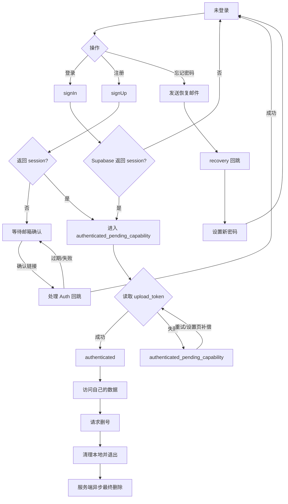
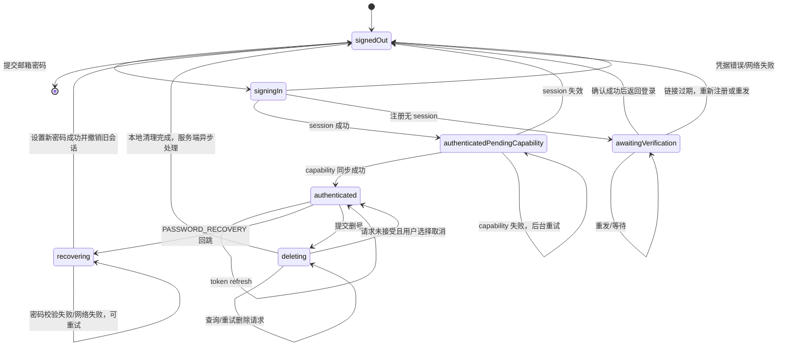

# 芥子账号与认证契约（PRD）

版本号：V0.1.0
日期：2026/07/31
状态：评审稿，未应用生产配置
基线：`origin/main@f72e63b0bc5fb4d1856493b0a846e605b64c8aa0`

| 版本 | 时间 | 修订人 | 备注 |
| --- | --- | --- | --- |
| V0.1.0 | 2026/07/31 | Codex | 收口 iOS、PWA、Supabase 认证状态和发布流程 |

## 一、概述

### 1.1 背景与目标

芥子保存财务、睡眠、饮食和图片等敏感个人数据。当前项目使用 Supabase 邮箱密码认证，但生产环境仍为自动确认、默认邮件服务和 `localhost` Site URL；iOS 还把 `upload_token` 的读取结果当成登录是否成功的条件，PWA 注册则把“有 user 但没有 session”的待确认账号当成已登录。

本需求的目标是建立一个跨 iOS/PWA 的、可恢复且可审计的账号闭环：

1. 新账号必须证明控制注册邮箱后才能进入受保护数据。
2. 登录成功与快捷指令上传凭据同步解耦，凭据失败不能把有效会话伪装成登录失败。
3. 验证邮件、密码恢复、登出、冷启动恢复和删号都必须有明确的成功、失败和重试出口。
4. 不在首版引入会触发额外账号绑定和审核复杂度的第三方登录；为 Apple 登录、邮箱 OTP 和 Passkey 保留扩展边界。

### 1.2 方案选择

| 方案 | V1 结论 | 原因 |
| --- | --- | --- |
| 已验证邮箱 + 密码 | **V1 采用** | Supabase 原生支持，跨 PWA/iOS 一致，恢复和审计路径清楚 |
| 邮箱一次性验证码/魔法链接 | V1.1 预留 | 需要稳定 SMTP、重放保护和回跳；可减少密码找回负担，但仍依赖邮箱 |
| Sign in with Apple | V1 不阻塞，V1.1 评估 | iOS 体验好，但涉及 Apple relay 邮箱、已有邮箱账号绑定、撤销和跨端身份合并 |
| 手机号/SMS | V1 不采用 | 国内外送达、成本、实名/合规和号码换绑风险高 |
| Passkey | 研究项 | 需要 WebAuthn/RP 配置和跨端恢复设计，当前 Supabase 账号契约未覆盖 |
| 微信/Google 等第三方登录 | V1 不采用 | 会扩大账号绑定面，并触发 App Store 等价隐私登录要求 |

“不局限于邮箱”的设计落点是：认证服务层使用 provider-neutral 的身份模型，业务数据只绑定 Supabase `auth.users.id`；未来增加 Apple/OTP 时只新增身份提供商和绑定流程，不改 `user_id`、同意记录、删号和数据权限模型。

### 1.3 角色与数据范围

| 角色 | 权限 | 数据范围 |
| --- | --- | --- |
| 普通用户 | 注册、登录、查看/编辑/导出/删除自己的数据 | 仅自己的 `auth.uid()` 数据 |
| 审核账号 | 与普通用户相同，使用独立合成数据 | 不得使用开发者个人账号或真实用户数据 |
| 运维/项目所有者 | 在 Supabase/GitHub 控制台配置 SMTP、Auth URL、Secrets 和发布授权 | 不通过客户端绕过 RLS，不读取用户明文数据 |

### 1.4 名词

| 名词 | 说明 |
| --- | --- |
| Auth session | Supabase SDK/JS 客户端持有的访问令牌和刷新令牌组合 |
| capability | 登录后从 `user_configs` 读取的 `upload_token`，只用于快捷指令上传，不代表登录状态 |
| confirmation | 注册邮箱确认流程；无 session 时账号处于待确认状态 |
| recovery | 忘记密码后的恢复会话；只能进入设置新密码流程 |
| deletion request | 异步删号请求；提交后客户端立即退出并清除本地数据，服务端后台最终删除 |
| legal version | 当前服务协议、隐私政策和敏感数据说明的版本号 |

## 二、产品描述

### 2.1 范围

**V1 必须包含：**

- 邮箱密码注册、登录和登出；
- 开启 Confirm email 后的待确认状态、重发确认邮件和过期提示；
- 密码重置邮件、回跳、设置新密码和旧会话撤销；
- iOS 与 PWA 的统一认证事件处理；
- 登录成功后异步补偿 `upload_token`；
- 历史账号的协议/隐私版本补充同意门禁；
- 异步删号后的 SDK 会话、Keychain、磁盘快照和图片缓存清理；
- 审核账号、弱网、重复提交、过期链接和回滚验收。

**V1 不包含：**

- 第三方 OAuth 登录；
- 手机号登录；
- 多账号合并和邮箱换绑；
- 自建密码/OTP 存储；
- 在客户端写入 SMTP 或 Supabase Service Role 凭据。

### 2.2 主流程

### 2.3 认证状态机

每个非终态都有出口。`authenticatedPendingCapability` 不是登录失败；`deleting` 不能在本地保留可恢复的旧 session；`recovering` 不能展示普通数据页面。

### 2.4 全局异常规则

| 场景 | 客户端状态 | 用户反馈 | 可执行出口 |
| --- | --- | --- | --- |
| 邮箱/密码错误 | `signedOut` | “邮箱或密码不正确” | 修改后重试 |
| 注册无 session | `awaitingVerification` | 显示邮箱、重发按钮和冷却时间 | 确认后返回登录 |
| 确认链接过期 | `awaitingVerification` | “链接已过期” | 重发 |
| 恢复链接过期 | `signedOut` | “重置链接已过期” | 重新发送 |
| Auth session 成功但 `upload_token` 读取失败 | `authenticatedPendingCapability` | “已登录，快捷指令凭据稍后同步” | 设置页重试 |
| 无网/超时 | 原状态不变 | 网络错误，不显示技术栈原文 | 重试 |
| RLS/权限错误 | 原状态不变 | “账号权限暂时不可用” | 刷新 session 或联系客服 |
| 删除请求已接受 | `signedOut` | 显示预计处理时长和查询编号 | 支持页查询/联系客服 |
| 删除请求未接受 | `authenticated` 或 `signedOut`，按本地是否清理决定 | 明确说明是否已退出 | 重试或联系客服 |

原始 Supabase 错误只写入内部诊断日志，用户界面使用稳定错误码映射，不展示 JWT、URL、SQL、邮箱服务商响应或内部表名。

## 三、功能需求

### 3.1 注册与邮箱确认

#### 用户故事

- 作为新用户，我希望注册后确认邮箱，确保只有我能访问财务和图片数据。
- 作为未及时收到邮件的用户，我希望在冷却结束后重发，而不是重复创建账号。

#### 规则

1. `signUp` 的成功条件是 `data.session != null`；仅有 `data.user` 不能进入已登录页面，也不能写入需要 session 的业务数据。
2. 无 session 时进入 `awaitingVerification`，展示已脱敏邮箱、重发按钮、冷却倒计时和更换邮箱入口。
3. 重发使用 Supabase `resend(type: "signup")`，客户端按钮冷却 60 秒；服务端邮件限流仍以 Supabase 和 SMTP 限制为准。
4. 确认链接只允许精确的 Site URL/Redirect URL；不接受任意回跳地址。
5. 历史账号首次登录时检查协议、隐私和敏感数据说明版本；缺任一当前版本则先进入同意页，完成后才加载业务数据和调用 Qwen。

#### 界面与验收

| 元素 | 行为 | 验收 |
| --- | --- | --- |
| 邮箱输入 | trim、大小写按 Supabase 处理，不在客户端记录明文 | 非法格式不可提交 |
| 重发按钮 | 60 秒冷却，显示下一次可用时间 | 重复点击不产生并发请求 |
| 返回登录 | 清理注册表单但保留脱敏提示 | 确认后可正常登录 |
| 确认回跳 | iOS 通过 SDK `handle(url:)`，PWA 通过 Supabase JS 事件 | 成功后 session 可被 `getSession()` 读取 |

### 3.2 登录与 capability 补偿

1. 先完成 Supabase `signIn` 并持久化 session，再尝试读取 `user_configs.upload_token`。
2. capability 读取失败不得回滚 session，不得显示“登录失败”。
3. 重试使用指数退避上限 3 次；设置页提供显式“重新同步快捷指令凭据”。
4. 没有 capability 仍可查看、编辑、导出和删除自己的记录；只有快捷指令上传入口显示待同步状态。
5. 用户切换账号时先取消旧用户的加载任务、清除旧快照和图片缓存，再应用新 session。

### 3.3 密码恢复

1. 登录页提供“忘记密码”；仅发送邮件，不根据邮箱是否存在透露账号存在性。
2. redirect 使用固定 `https://snapflow.me/?auth_action=recovery`（PWA）和 `jiezi://auth/recovery`（iOS）；确认邮件分别使用 `https://snapflow.me/?auth_action=confirm` 与 `jiezi://auth/confirm`。四个地址都必须逐项加入 allowlist，不使用通配符。
3. 回跳事件为 `PASSWORD_RECOVERY` 时只进入 `recovering`，不加载业务首页。
4. 新密码至少 8 位，设置成功后撤销旧 session，回到登录页；不能自动绕过同意版本门禁。
5. 链接过期、重复使用、取消和弱网都有重新发送出口。

### 3.4 登出与本地清理

1. 优先调用 Supabase SDK `signOut(scope: .local)`；无论服务端结果如何，都执行本地 Keychain、用户快照、record detail cache 和图片缓存清理。
2. SDK signOut 失败只记录可诊断错误，不阻塞用户离开当前账号。
3. 冷启动不得从被登出的旧 session 或磁盘快照恢复到已登录页面。
4. PWA 的 `SIGNED_OUT` 事件由 `App.vue` 唯一处理；`AuthPage` 不再直接修改登录状态或调用 `loadData()`。

### 3.5 异步删号

1. 删除请求必须幂等；服务端返回 request id、当前状态和预计处理时长。
2. 客户端在服务端接受请求后立即 SDK signOut、清 Keychain、清快照/图片缓存并进入 `signedOut`。
3. 客户端不得在删除完成前保留可自动恢复的 refresh token。
4. 账号删除 worker 沿用 `requested/cleaning/deleting/completed/failed`；图片清理队列另有 `pending/processing/done/failed/dead_letter`。两套状态必须分别可查询、可重试或转人工处理。
5. 支持页/设置页显示最近一次请求状态、失败原因的用户友好版本和联系客服入口，不显示内部队列 payload。

### 3.6 认证服务接口契约

| 方法 | 输入 | 成功输出 | 失败处理 |
| --- | --- | --- | --- |
| `signIn` | email、password | Auth session | 映射为稳定错误码 |
| `signUp` | email、password、同意版本 | session 或 `awaitingVerification` | 不用 `user` 代替 session |
| `resendConfirmation` | email | accepted | 60 秒冷却，防账号枚举 |
| `sendPasswordReset` | email、redirect | accepted | 不透露邮箱是否存在 |
| `handleAuthCallback` | URL | session/event | 校验 scheme、host、state、PKCE |
| `updatePassword` | new password | session invalidated | 回到登录页 |
| `fetchUploadToken` | user id、access token | capability | 后台补偿，不回滚 session |
| `signOut` | none | local state cleared | 服务端失败不阻塞本地退出 |
| `deleteAccount` | access token | request id/status | 幂等、可查询、可重试 |

### 3.7 数据字典

| 字段 | 类型 | 必填 | 说明 |
| --- | --- | --- | --- |
| `auth.users.id` | UUID | 是 | 唯一用户主键，业务表通过 `user_id` 引用 |
| `auth.users.email` | string | 是 | Supabase 管理的登录邮箱，不复制密码 |
| `email_confirmed_at` | timestamp | Confirm email 开启后 | 邮箱确认时间 |
| `user_configs.upload_token` | secret string | capability 可用时 | 不作为登录状态；客户端仅存 Keychain/安全存储 |
| `user_configs.terms_version` | string | 是 | 当前服务协议版本 |
| `user_configs.privacy_version` | string | 是 | 当前隐私政策版本 |
| `user_configs.legal_consent_at` | timestamp | 是 | 同意服务协议和隐私政策的服务端时间 |
| `user_configs.sensitive_data_consent_at` | timestamp | 是 | 同意敏感数据处理/跨境 AI 路由的服务端时间 |
| `user_configs.sensitive_data_version` | string | V1 迁移后 | 新增的敏感数据说明版本；迁移前不能假定该字段存在 |
| `account_deletion_requests.id` | UUID | 是 | 异步删号查询编号 |
| `account_deletion_requests.status` | enum | 是 | 现状为 `requested/cleaning/deleting/completed/failed`；若增加终止失败态必须单独迁移 |
| `account_deletion_requests.created_at` | timestamp | 是 | 服务端时间 |
| `account_deletion_requests.completed_at` | timestamp | 否 | 最终完成时间 |

密码、SMTP 凭据、Service Role key、refresh token 和真实用户记录不进入 Git、测试 fixture、PR 或日志。`sensitive_data_version` 是待评审的兼容迁移，不得在客户端先行写入不存在的列。

## 四、非功能与发布要求

### 4.1 Supabase/Auth 配置（由项目所有者在控制台执行）

1. 配置自定义 SMTP；首选 Resend，若主要用户为 QQ/163，再用合成账号对比阿里云邮件推送的送达率。
2. 使用专用发件地址，例如 `noreply@snapflow.me`，完成 SPF、DKIM、DMARC。
3. `mailer_autoconfirm=false`；Site URL 使用生产 HTTPS 地址，不保留 `localhost`。
4. Redirect allowlist 只加入生产 PWA 回调和已登记的 iOS 回调，不加入通配符。
5. 逐项核对邮件限流、泄露密码保护、会话时长和刷新策略；配置值由控制台/安全 Secrets 管理，不写进仓库。

### 4.2 iOS/PWA 集成边界

- iOS V1 通过 Supabase Swift `session(from:)` 显式交换 PKCE code；`jiezi://auth/confirm` 与 `jiezi://auth/recovery` 使用不同 path，不能靠 PKCE 回跳中不稳定的 `type` 参数猜测流程。`Info.plist` 已注册 `jiezi` scheme，Universal Link 留作后续加固。
- PWA 由 `App.vue` 订阅 Auth 状态；`AuthPage` 只负责表单和状态展示。
- iOS 和 PWA 都以 Auth session 为登录真相源，`upload_token` 是独立 capability。
- 所有回跳处理都必须区分普通登录、邮箱确认、密码恢复和错误回跳。

### 4.3 安全、隐私与运维

- 登录、重发和恢复接口使用服务端限流；客户端冷却只是体验层保护。
- 埋点只记录稳定事件名、状态码和耗时，不记录邮箱、token、URL query、邮件正文或用户数据。
- 生产配置变更、Edge 部署、数据库迁移和 TestFlight 各自需要单独授权。
- 迁移先兼容旧客户端，再切 Confirm email；确认开关打开前必须完成 SMTP、回跳和重发测试。
- 任何凭据泄露按交接规范立即轮换，不在聊天或命令输出复述旧值。

### 4.4 目标指标

| 指标 | 目标 |
| --- | --- |
| 注册确认成功率 | 合成测试邮箱在 5 分钟内收到并完成确认；按邮箱服务商分组观察 |
| 登录成功但 capability 失败 | 不阻塞登录；失败后 3 次补偿或显示设置入口 |
| 重置链接重复使用 | 第二次被拒绝并给出重发出口 |
| 登出后冷启动 | 100% 进入未登录页，不恢复旧用户快照 |
| 删号请求 | 接受后立即本地退出；队列失败可查询、可重试、无死状态 |

## 五、开发、测试与上线流程

### 5.1 分支与提交拆分

全部工作从 `codex/auth-account-contract` 开始，完成一组验证后再拆短期 PR：

1. `docs(auth): 定义账号与认证状态契约`：只包含本文档和待确认项。
2. `fix(auth-ios): 解耦登录与快捷指令凭据`：session、Keychain、删号本地清理和单测。
3. `fix(auth-pwa): 修复待确认注册与统一会话加载`：以 session 为准、重发入口、取消 AuthPage 重复加载。
4. `feat(auth-callback): 增加确认与密码恢复回跳`：iOS/PWA callback、更新密码和过期提示。
5. `test(auth): 补齐跨端认证验收`：单测、PWA 流程测试和手工验收表。

禁止整包 cherry-pick 旧发布分支；每个提交只暂存审查过的文件，不使用 `git add -A`。

### 5.1.1 当前实现状态（2026/08/01）

| 能力 | 代码状态 | 上线前仍需 |
| --- | --- | --- |
| PWA 注册/会话判定 | 已改为只以 `session` 进入业务页 | 浏览器实测 Confirm email 开关后的完整流程 |
| PWA 重发与找回密码 | 已实现 60 秒冷却、回跳门禁、稳定错误文案和 URL 清理 | 使用生产域名和非项目成员邮箱验证邮件模板/过期链接 |
| iOS 确认与恢复 | 已实现 PKCE 回跳分流、URL scheme、重发、改密和恢复态冷启动保护 | macOS CI 编译、真机从邮件打开四类链接 |
| capability 补偿 | iOS 登录已与 `upload_token` 解耦，设置页可重试 | 弱网和跨账号切换测试 |
| 登出/删号本地清理 | iOS 已清 SDK session、Keychain、快照及两类图片缓存 | 服务端删号状态查询、预计时长和完成确认仍未实现 |
| 历史同意门禁 | 契约已定义 | 客户端同意页及服务端 Qwen 门禁仍未实现 |

当前代码可以继续进入 CI/真机联调，但不能据此直接开启生产 Confirm email，也不能提交 App Review。

### 5.2 阶段门禁

| 阶段 | 工作 | 通过条件 | 生产动作 |
| --- | --- | --- | --- |
| 0. 分支保护 | 完成备份、保留 refs、从 `origin/main` 建新分支 | `git bundle verify`、哈希清单全绿 | 无 |
| 1. 契约 | 评审本文档和状态机 | 无未闭合状态；确认待决项 | 无 |
| 2. 代码 | iOS/PWA/回跳/删号本地清理 | 静态检查、单测、无敏感数据 | 无 |
| 3. SMTP 预演 | 在 Supabase 测试项目或受控生产配置验证 | 非项目成员邮箱收发成功 | 仅 Auth 控制台配置 |
| 4. 集成验收 | QQ、163、Outlook、Gmail、iCloud 合成账号 | 注册、确认、重发、恢复、登出、删号全通过 | 无 |
| 5. PR 复审 | 从固定 head 运行 PWA/Edge/migration/iOS checks | CI 全绿、人工审查通过 | 无 |
| 6. 合并发布 | 先合并 PR #19；再按单独授权处理 PR #20 的 PWA 更新 | `main` 产生固定 SHA | 可能触发 PWA/Edge workflow |
| 7. TestFlight | 从最终 `main` SHA 构建 | 真机登录、恢复、删号记录已填写 | 仅手动触发 TestFlight |
| 8. 审核 | 使用独立审核账号和样例数据 | Review Notes、隐私标签、支持页齐全 | 提交 App Review |

### 5.3 真机/浏览器验收矩阵

| 用例 | iOS | PWA | 结果要求 |
| --- | --- | --- | --- |
| 新注册无 session | ✓ | ✓ | 停在待确认，不进入首页 |
| 确认邮件成功回跳 | ✓ | ✓ | 重新登录后可加载数据 |
| 重发冷却/过期 | ✓ | ✓ | 不重复发请求，有明确重试出口 |
| 正常登录 | ✓ | ✓ | capability 失败也仍为已登录 |
| capability 补偿 | ✓ | ✓ | 设置页重试成功，不丢 session |
| 忘记密码/设置新密码 | ✓ | ✓ | recovery 页面不展示业务数据 |
| 冷启动/刷新 token | ✓ | ✓ | 只恢复当前用户 |
| 登出后冷启动 | ✓ | ✓ | 无旧快照、无旧图片、无旧 token |
| 异步删号 | ✓ | ✓ | 本地立即退出，状态可查询，最终删除可验证 |
| 历史账号版本同意 | ✓ | ✓ | 未同意前不调用业务/AI 数据链路 |

## 六、评审结论与待确认项

### 6.1 多角色评审结论

**结论：有条件通过进入开发；不可直接上线。**

| 级别 | 问题 | 责任 | 通过条件 |
| --- | --- | --- | --- |
| P0 | 生产无自定义 SMTP、Site URL/redirect 不正确 | 运维/项目所有者 | 配置完成并用非项目成员邮箱实测 |
| P0 | iOS 异步删号后未清 SDK session 与磁盘快照 | 研发 | 单测和真机冷启动均无旧数据 |
| P0 | Confirm email 开启后 PWA 用 `user` 冒充已登录 | 研发 | 只以 `session` 进入业务，待确认页可重发 |
| P1 | 登录与 `upload_token` 强耦合 | 研发 | capability 失败不阻塞登录，补偿可重试 |
| P1 | 缺少恢复回跳和新密码页面 | 研发/设计 | iOS/PWA recovery 状态和过期出口齐全 |
| P1 | 历史账号缺当前同意版本 | 产品/后端 | 服务端和客户端双重版本门禁 |
| P2 | Apple/OTP/Passkey 尚未实现 | 产品 | 明确列为 V1.1/研究项，不阻塞 V1 |

### 6.2 状态机强制复核

| 实体 | 当前状态 | 合法后续 | 出口 |
| --- | --- | --- | --- |
| 认证会话 | `signedOut` | `signingIn` | 提交表单 |
| 认证会话 | `signingIn` | `authenticatedPendingCapability`、`awaitingVerification`、`signedOut` | session/错误分支 |
| 认证会话 | `awaitingVerification` | `awaitingVerification`、`signedOut` | 重发、确认、过期 |
| 认证会话 | `authenticatedPendingCapability` | `authenticated`、自身、`signedOut` | 补偿、刷新、失效 |
| 认证会话 | `recovering` | `recovering`、`signedOut` | 重试、改密成功/过期 |
| 认证会话 | `deleting` | `deleting`、`signedOut`、取消回到 `authenticated` | 查询/重试/取消 |
| 删号请求 | `requested` | `cleaning`、`failed` | worker 领取或失败重试 |
| 删号请求 | `cleaning` | `deleting`、`failed` | 图片/业务数据清理完成或失败 |
| 删号请求 | `deleting` | `completed`、`cleaning`、`failed` | Auth 最终删除、回到清理或失败 |
| 删号请求 | `failed` | `cleaning`、人工终止 | 重试或客服升级；不得无声卡死 |
| 图片清理队列 | `dead_letter` | `pending`、`done`、人工终止 | 这是图片队列状态，不等同于账号请求状态 |

### 6.3 必须确认的假设

1. [待确认] 生产发信服务选 Resend 还是阿里云邮件推送；以 QQ/163/Outlook/Gmail/iCloud 合成账号实测结果决定。
2. [已决策] iOS V1 先采用固定自定义 scheme：`jiezi://auth/confirm` 与 `jiezi://auth/recovery`；上线前完成精确 allowlist 和 PKCE 真机验证，Universal Link 放入后续加固。
3. [待确认] 历史账号补充同意时，是否允许只在登录后拦截，还是在收到任一业务请求时由 Edge 再拦截一次；建议双层门禁。
4. [待确认] 删除队列对用户承诺的最大处理时长和客服升级 SLA；建议文案不要承诺未验证的分钟数。
5. [待确认] V1 是否把邮箱 OTP 放入实验开关；建议先完成密码恢复，再以独立实验评估。

### 6.4 不能合并/上线的条件

- 未配置自定义 SMTP 就打开 Confirm email；
- 只改客户端、不补 Auth callback 和服务端同意/Qwen 门禁；
- 把 capability 失败显示为登录失败；
- 删除请求接受后仍保留 refresh token、快照或图片缓存；
- 用真实个人账号作为审核账号，或把真实邮件/用户数据写入日志；
- 未从最终 `main` 固定 SHA 重建 TestFlight 就提交审核。
